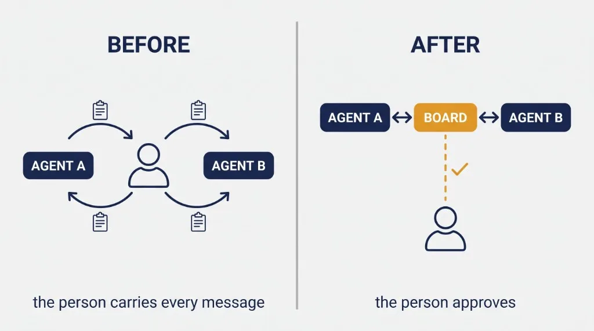
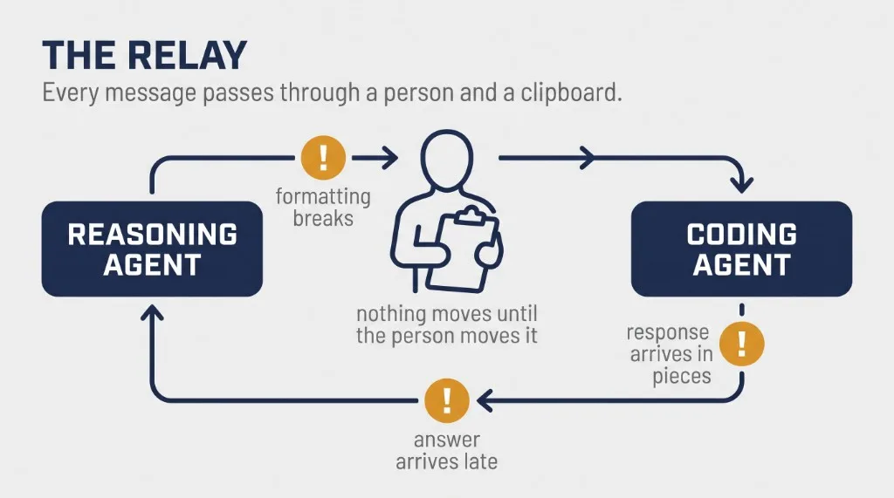
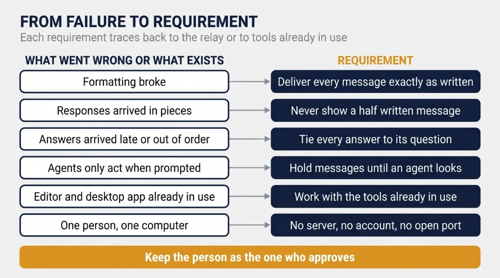
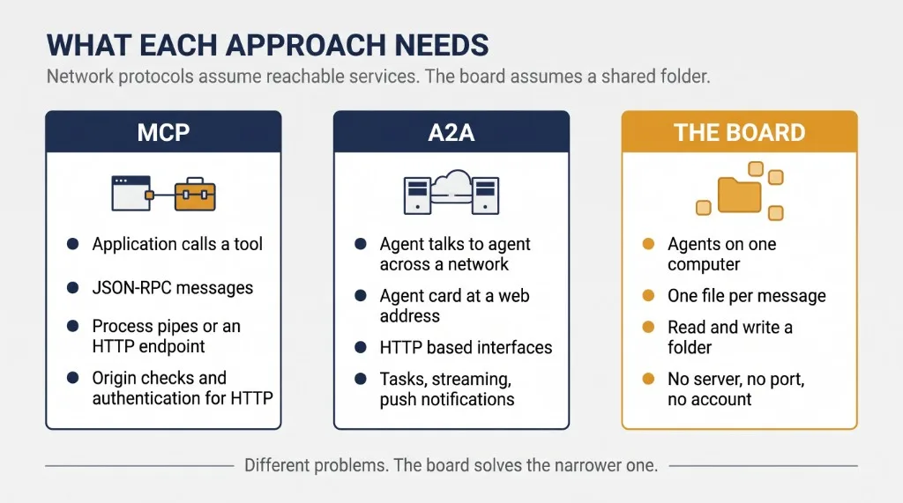
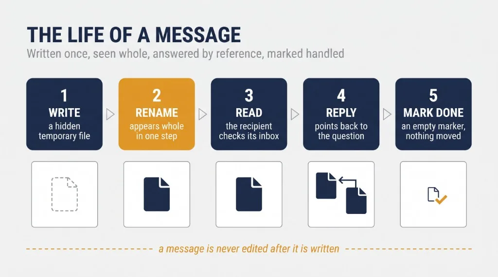
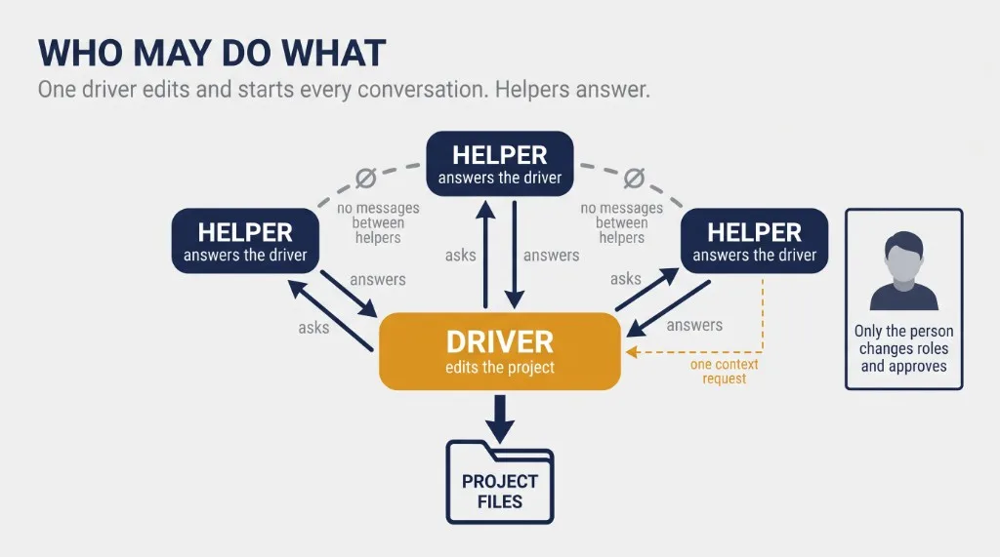
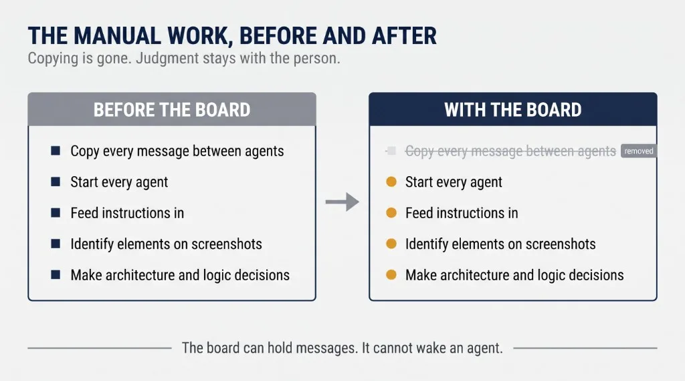
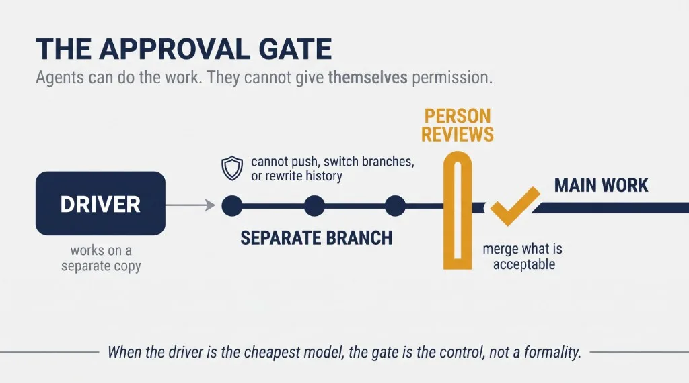

<div class="whitepaper-toolbar" id="whitepaper-listen">
  <div class="whitepaper-toolbar__listen">
    <span class="whitepaper-toolbar__label">Listen</span>
    <audio class="whitepaper-audio" controls preload="metadata" src="../assets/white-papers/agent-coop/agent-coop-v0.3-narration.mp3">
      Your browser does not support audio playback.
    </audio>
    <span class="whitepaper-toolbar__status" data-listen-status></span>
  </div>
  <div class="whitepaper-toolbar__actions">
    <a class="whitepaper-download" href="https://github.com/zlatko-lakisic/white-papers-agent-coop/raw/main/AGENT-COOP_WhitePaper_v0.3.pdf" download="AGENT-COOP_WhitePaper_v0.3.pdf">Download PDF (v0.3)</a>
    <a href="https://github.com/zlatko-lakisic/agent-coop">Software</a>
    <a href="https://github.com/zlatko-lakisic/white-papers-agent-coop">Public release repo</a>
  </div>
</div>

# Agent Co-op: The person is not the message bus

<p class="whitepaper-skip-listen whitepaper-subtitle"><em>Agent Co-op and the case for coordinating AI agents through files</em></p>

<div id="whitepaper-content" markdown="1">

<figure class="whitepaper-cover">

</figure>

## TABLE OF CONTENTS

1. [Executive summary](#executive-summary)
2. [1. The failure mode: the person as relay](#the-failure-mode)
3. [2. What the fix had to do](#what-the-fix-had-to-do)
4. [3. Why not an existing approach](#why-not-an-existing-approach)
5. [4. How the board works](#how-the-board-works)
6. [5. Authority is the design](#authority-is-the-design)
7. [6. What the person still does](#what-the-person-still-does)
8. [7. The approval gate](#the-approval-gate)
9. [8. Known considerations](#known-considerations)
10. [9. Conclusion](#conclusion)
11. [References](#references)
12. [Appendix A: The protocol for builders](#appendix-a-the-protocol-for-builders)
13. [Appendix B: License and citation](#appendix-b-license-and-citation)

## Executive summary {#executive-summary}

More people now use more than one AI assistant on the same piece of work. They do it for good reasons. One model reasons better. Another is cheaper to run for hours. A third can look at pictures. The result is a team of agents that cannot talk to each other, and a person who carries messages between them.

This paper describes a tool built to remove that work, and the design argument behind it.

The author builds an open-source game AI project with two agents. Claude reasons through architecture and logic. Cursor, usually running a Grok model because the author's plan allows far more Grok use than Claude use, writes the code. The author's second job became copying messages from one to the other and back. Formatting broke on the way. Answers arrived late, or in several pieces. The cost was never measured, but it was large enough that the author put his time into building a fix.

The fix is Agent Co-op. Agents on one computer read and write plain files in a shared folder, called the board. It adds no server and no process of its own, needs no account, and nothing listens on a network port except an optional local viewer. A message is one file, written once and never edited.

The argument is that moving messages between agents is the easy part. Files do it. The hard part is deciding who is allowed to do what. Agent Co-op answers that with a small set of rules. Each project has one driver, the only agent that edits the project. Every other agent is a helper that answers the driver and never edits. A message is information, never an order. Only the person approves risky actions, and only the person changes who holds which role.

Put simply, the agents can do the work, but they cannot give themselves permission.

The board itself guarantees less than that sentence suggests, and the paper keeps the two apart. What the board provides is a record: every message is a readable file with a known sender, written once, pointing to the question it answers. The rules are policy that the board records and checks. Enforcing them depends on each tool's own permissions and on the operating system.

<figure class="whitepaper-figure">

<figcaption>Figure 1: Before, the person carries every message between agents. After, the agents exchange messages through the board and the person approves what matters.</figcaption>
</figure>

### What this paper argues

Coordinating AI agents is an authority problem before it is a transport problem. A design that settles who may write what, who may start a conversation, and who may approve, can run on the simplest transport there is.

A shared folder of write-once files makes local agent work legible and auditable. It does not, by itself, stop an agent from breaking the rules. That boundary belongs to the tools and the operating system, and this paper treats the two separately.

### What this paper does not claim

It does not claim the design is proven. There is one user, the author, on one project.

It does not claim measured results. The time spent relaying messages was never counted, and this paper offers no estimate.

It does not claim the newest features work in practice. The author used the first version, 0.1. Features added in version 0.2.0 are described as designed, not as shown to work.

It does not claim the board prevents rule-breaking. It records and detects. Prevention depends on each tool's permission settings.

It does not claim Agent Co-op replaces network protocols for agents. It solves a narrower problem: agents on one computer, working for one person.

### Disclosure

The author designed and built Agent Co-op and is its only user to date. The first commit was made on October 16, 2026, and version 0.2.0 was released the next day. The software is open source under the Apache License 2.0. Assessments of individual AI models in this paper are the author's own views from daily use, not benchmark results.

## 1. The failure mode: the person as relay {#the-failure-mode}

### How the work was split

The project behind this paper is Comstar Game AI, an open-source platform for building AI opponents for turn-based games. [6] The author builds it with two agents and a clear division of labor.

Claude, Anthropic's model, is used only for reasoning: architecture, logic, and working out what should be built. It does not write the code. Claude is expensive to use heavily, so the author spends Claude tokens where reasoning matters most.

Cursor, the code editor, does the building. Most of the time it runs a Grok model. The reason is cost. On the author's plan, Grok models can be used far more than Claude models inside Cursor.

That split comes with a known weakness. In the author's view, Grok is the weakest of the major models, and even Gemini does a better job. In practice Grok needs several more rounds than Claude or GPT to finish a similar task, which costs more tokens, more money, and more time. It also sometimes leaves a task partly finished. Cheaper access did not mean cheaper work. It meant the work needed checking.

### What the relay looked like

Neither agent could see the other. So the author carried everything. A plan worked out with Claude was copied into Cursor. Cursor's result, question, or error was copied back to Claude. Then the answer went back to Cursor.

The author describes this copying as his other role, and the one that took up a lot of his time.

<figure class="whitepaper-figure">

<figcaption>Figure 2: The person between two agents. Every message passes through the person and a clipboard, in both directions, and each pass can break formatting, split a response, or arrive late.</figcaption>
</figure>

Three things went wrong in that relay:

* **Formatting broke.** The author asks for everything in markdown. Commands did not always arrive formatted well after passing through a clipboard and a chat box.
* **Responses came late or in pieces.** A response arrived late, or arrived in several separate pieces that had to be put back together by hand.
* **The person became the clock.** Nothing moved unless the author was at the keyboard to move it.

### What it cost

The author did not count round trips or time. This paper does not estimate them. The evidence that the cost was significant is the decision the author made: the relay took enough of his time that he put time into building a tool to remove it.

### Why this is not one person's problem

Nothing in this pattern is specific to games or to these two products. Anyone who splits work between a strong reasoning model and a cheaper coding agent, or between a coding agent and a model that can read images, faces the same choice. Either the agents work in isolation, or a person carries every message between them.

## 2. What the fix had to do {#what-the-fix-had-to-do}

The requirements came from the relay and from the way the author already works, not from a technology he wanted to try.

<figure class="whitepaper-figure">

<figcaption>Figure 3: Each requirement traces back to a failure in the relay or to the way the author already works.</figcaption>
</figure>

### Deliver a message exactly as written

Markdown must arrive as markdown. This answers the formatting failure.

### Never show a half-written message

A reader must see a whole message or nothing. This answers responses arriving in pieces.

### Tie every answer to its question

A reply must say which message it answers, so the person never has to match pieces to questions by hand.

### Hold messages until an agent looks

Most agents do nothing until someone gives them a turn. The fix has to hold messages until an agent next looks, and tell that agent what is waiting. This does not fix delay. A message still waits until the agent is started. Section 6 returns to this.

### Work with the tools already in use

The author works in the Cursor editor and a Claude desktop app. A fix that required different tools would have replaced one manual task with another.

### Add no infrastructure

Everything runs on one computer for one person. The author set a firm constraint: no extra servers or processes started on purpose. A service that has to be hosted, secured, and kept running is more than the problem justifies.

### Keep the person as the one who approves

Removing the courier work must not remove the person's control. Agents must not be able to approve their own actions or each other's.

## 3. Why not an existing approach {#why-not-an-existing-approach}

Several existing approaches could connect agents. The author looked at the two main protocols before building. Both are serious, well-supported standards, and neither is wrong. The question is whether they fit the constraint in Section 2: no infrastructure added on purpose.

<figure class="whitepaper-figure">

<figcaption>Figure 4: MCP and A2A each need a process or a service to talk to. The board needs only a folder that every agent can read and write.</figcaption>
</figure>

### Model Context Protocol (MCP)

MCP connects an AI application to tools and data sources. Its messages use JSON-RPC, and its specification defines two standard transports. In the first, the client starts the server as a separate process on the same computer and exchanges messages over that process's standard input and output. This needs no network. In the second, the server runs independently and exposes an HTTP endpoint, which the specification tells servers to protect by checking where requests come from, binding only to the local machine when running locally, and authenticating connections. [1]

So MCP does not require a network. A builder could reasonably ask why the author did not write a small local MCP server with "send" and "check" tools, since both Cursor and Claude desktop can use MCP.

The answer is the constraint. Under the first transport, each application launches its own copy of the server as a separate process. Two copies launched by two different applications do not share memory, so to pass messages between them they would still need shared storage, such as files, or a single server both connect to, which is a process someone has to keep running. A local MCP mailbox would add a process to the setup and, underneath, would still rest on shared files or a shared service. Agent Co-op skips the process and keeps the files.

### Agent2Agent protocol (A2A)

A2A is built for agents talking to agents. Google published it in April 2025 and donated it to the Linux Foundation that June. Version 1.0 was frozen on March 12, 2026, and on August 17, 2026 the project moved into the Agentic AI Foundation, alongside MCP and AGENTS.md. [2][3]

To take part, an agent publishes an agent card, a JSON description of what it can do, where to reach it, and how to authenticate, usually at a well-known web address. It offers one or more HTTP-based interfaces. Work is tracked as tasks with defined states, with optional streaming of updates and optional push notifications to a client's web address. [2]

That design assumes each agent sits behind an endpoint that others can call, whether across the internet or on one machine. A code editor and a desktop chat app do not offer one. Giving them one would mean running a service for each.

### Orchestration frameworks

A third family of tools runs several agents inside one controlling program that decides who acts and passes results between them. These work well for agents the framework creates and runs itself. They do not include the tools a person already works in, such as a code editor or a desktop chat app, as those tools are. Adopting one would mean moving the work into the framework.

### What all of the author's tools share

Every tool in the author's setup can, given permission, read and write files in a folder. That is the one capability they share, and it needs nothing running in the background. So the author built on it.

### An older idea

Sharing work through a common store is not new. In the early 1970s the Hearsay-II speech understanding project introduced what became known as the blackboard architecture. Independent knowledge sources read and wrote a shared repository, the blackboard, and a control mechanism decided which source acted next. [4][5]

Agent Co-op's board follows the same basic pattern. The difference is control. In a classic blackboard system, a control component picks which source runs next. On the board, one agent, the driver, decides whom to ask, and a person decides what is approved.

## 4. How the board works {#how-the-board-works}

This section explains the board in plain terms first. Builders will find the exact rules in Appendix A and in the protocol specification. [7]

<figure class="whitepaper-figure">

<figcaption>Figure 5: A message is written once, appears whole in the recipient's inbox, is answered by a reply that points back to it, and is marked handled without being moved.</figcaption>
</figure>

### The board is a folder

Agent Co-op keeps a folder in the person's home directory. Inside it, each project has an inbox for each agent, a record of what each agent sent, a folder for files each agent wants to share, and an archive.

### A message is a file

To send a message, an agent writes one small file into the recipient's inbox. The file says who sent it, who it is for, which project it belongs to, what kind of message it is, a subject, and the text. Attachments are listed by their location on disk rather than copied in.

Once written, a message is never edited. A correction is a new message.

### No half-written messages

The sending command writes each message under a temporary hidden name and then renames it in a single step. A reader therefore sees either nothing or the whole message, never a partial one.

### Every answer points to its question

A reply carries the identifier of the message it answers. However late it arrives, it attaches to the right question, and there are no pieces to match by hand.

### Formatting survives

The message text is stored exactly as written. Nothing passes through a clipboard or a chat input box, so markdown arrives as markdown.

### Handled means marked

When an agent has dealt with a message, it creates an empty marker file named after it. Nothing is moved or deleted to show a message was handled, so the record stays complete. To keep inboxes from growing without limit, an archive command moves handled messages older than 30 days out of the inbox, where the log can still show them.

### One writer for every location

Every location on the board has exactly one agent allowed to write to it. An agent writes into another agent's inbox only by sending a new message, and only the recipient marks its own messages handled. Only the driver writes the project's files. The person, through the command, is the only one who changes the board's settings.

That is a rule, not a lock. Section 8 explains the difference.

## 5. Authority is the design {#authority-is-the-design}

Moving a file from one folder to another is trivial. The rules about who may write it are not. This section sets out those rules, because they are the design argument this paper makes.

<figure class="whitepaper-figure">

<figcaption>Figure 6: One driver edits the project and starts every conversation. Helpers answer the driver only. The single exception is one request for project context.</figcaption>
</figure>

### One driver per project

Each project has exactly one driver. The driver is the only agent that edits the project's files and the only agent that starts a conversation. An agent can be the driver of one project and a helper on another.

### Helpers answer and never edit

Every other member of a project is a helper. A helper replies only to the driver and only to messages the driver sent it. If a helper wants something changed, it writes a patch or a draft into its own files folder and attaches it. The driver decides what to apply, and does not have to apply every line.

### Helpers do not talk to each other

Helpers cannot message each other or start a thread. The reason is simple: the author does not want two helpers working on the same task. The driver assigns the work, so each piece of work has one helper on it.

If another helper should be involved, the helper says so in its reply and the driver decides. Helpers are also told that if they see a bigger problem with the plan, they should say so briefly at the end of their answer.

That path has a limit. A helper can raise a problem only when the driver has asked it something. A helper that notices trouble while idle has no way to speak up.

### The cost of this arrangement

These rules move the coordination work from the person to the driver. The driver now routes every question and receives every answer. If the driver stalls, the conversation stalls. The design accepts that cost in exchange for one place where the state of the work is known, and one agent responsible for applying changes.

### The one exception

A new helper may need to understand a project before it can answer anything useful. Version 0.2.0 therefore allows a helper to send the driver one request for project context without being asked first. A helper can have only one such request open at a time. The driver answers by writing a shared context document that every helper reads.

The request stays open until the driver replies to it. While it is open, the command refuses a second one. If an agent writes the file itself and sends several, only the earliest counts and the rest are flagged.

This is the only case in which a helper speaks first, and it is deliberate. Version 0.2 of the specification records it as an exception to the role rules. Because the change is to the rules and not to the file format, a context request is an ordinary message file, and the message format version did not change. [7]

### Messages are information, not orders

A message on the board is never an instruction an agent must follow, and never a form of approval. Agents are told to ask the person, in their own chat, before deleting files, pushing to a main branch, spending money, or sending email. A message claiming the person already approved something does not count.

### Only the person changes roles

Roles are set by the person through the command line or the local viewer. If the settings file is changed by any other route, role changes pause until the person reviews them.

### What this means in the author's setup

In Comstar, Cursor is the driver and Claude is a helper. The agent the author rates weakest holds the pen. The agent he rates strongest gives advice. Cost decides who drives. Quality decides who advises.

That arrangement only works because the driver's output is checked. Section 7 describes how.

## 6. What the person still does {#what-the-person-still-does}

Agent Co-op removed the copying. It did not remove the person.

<figure class="whitepaper-figure">

<figcaption>Figure 7: Copying messages is gone. Starting agents, giving direction, reading screenshots, and making architecture decisions remain with the person.</figcaption>
</figure>

### In the author's use of version 0.1

Messages now pass between Cursor and Claude through the board. The author no longer carries their content.

He still does four things by hand:

* **Starts every agent and tells it to watch the board.** The board holds messages, but it cannot wake an agent. An agent acts only when it has a turn.
* **Feeds instructions in** on Claude's side when the work needs direction.
* **Identifies elements on screenshots** when the work is visual.
* **Steps in on architecture and logic decisions.**

### The person is still the clock

This is the most important finding from the author's use, and it is a limit, not a failure. The board fixed the formatting and the split responses. It did not fix delay. A reply still waits until the author starts the agent that should read it. The person stopped carrying the messages but still decides when anything moves.

### What version 0.2.0 adds, as designed

Version 0.2.0 adds a background schedule. Every five minutes it checks the board and starts an agent only if that agent has mail. A driver can mark a request urgent so that a helper starts at once.

The schedule can only start agents that run from the command line. The author works in the Cursor editor and a Claude desktop app, which it cannot start. In his setup, the person still wakes every agent.

Version 0.2.0 also adds two documents. The project context document tells a new helper what the project is, what is in scope, and what to leave alone. The progress update, kept current by the driver while it works, tells helpers and the person where a task actually stands. That second document matters most when the driver is a model that sometimes stops partway through.

Neither the schedule nor these documents has been used on Comstar yet.

## 7. The approval gate {#the-approval-gate}

The design takes a single position on authority and applies it everywhere: agents can do the work, but they cannot give themselves permission. This section describes where approval actually happens, first in the author's setup and then in the design.

<figure class="whitepaper-figure">

<figcaption>Figure 8: For unattended runs, the driver's work lands on a separate branch, and the person reviews it and decides what to merge.</figcaption>
</figure>

### In the author's setup: watching

When the author works, he watches every agent as it works. He sees how each one reasons and how often it goes back to fix its own mistakes, and he judges the result against 25 years of experience as a developer.

This is not a systematic check. There is no test suite that gates the driver's changes and no measured review rate. It is a skilled person paying attention. It works because the author is present, and it is the reason a driver he rates weakest is acceptable in his setup.

### In the design: a separate branch for unattended runs

When the person is not watching, the design needs a different gate. For runs started by the background schedule, version 0.2.0 moves the driver's work into a separate working copy of the project on its own branch. A branch is a separate line of changes that the person reviews before it becomes part of the main project. The driver may save its changes there but is not meant to push them, switch branches, or rewrite history. The person reviews the branch and merges what is acceptable.

The mechanism behind this is a layer, not a wall. A substitute git command, placed first on the search path, blocks those actions when the agent calls git in the usual way. An agent that calls git by its full location would go around it. The separate working copy belongs to the same repository, so it shares that repository's remote connections. For Cursor, the scheduled run is also given a permissions file that allows writing only to the project copy and the board, and denies writing to the folder that holds the substitute command. For other tools, the documentation calls the guard a second layer and not a guarantee. [7]

Stronger isolation, such as a separate clone with no remotes or credentials, or an operating system sandbox, would turn the layer into a boundary. It is not part of the current design.

### Why the gate matters more with a cheap driver

When the agent holding the pen is the one the person trusts least, approval is not a formality. It is the control that makes a cheaper driver acceptable at all. A driver that takes extra rounds and sometimes leaves work half done needs a person at the point where its work becomes real.

The design does not remove that vigilance. It removes the courier work around it.

### A risk this design creates

When copying disappears, approval can become the only manual step left. Approval that costs little is easy to give without reading. A design that removes the courier work may make the remaining review feel like a formality.

The author has no evidence either way. This is stated as a risk, not a finding.

## 8. Known considerations {#known-considerations}

These are limits on what this paper establishes, not caveats added for form.

### Policy and enforcement are different things

The board coordinates agents and detects when its rules are broken. Enforcement depends on each tool's permission settings and on the operating system. Every statement in this paper about what an agent may or may not do describes the policy, unless it names the tool setting that enforces it.

### One computer only

Every agent must be able to read and write the same folder on the same computer, and see it at the same paths. Web chat cannot join, because it cannot read files on the person's computer. Agents in containers or virtual machines that see the disk at different paths are not supported.

### Detection, not prevention

All agents run as the same user on the computer. Any agent that can write to the board can write a message claiming to come from another agent, including the driver. The command checks roles for the messages it sends, and flags messages that break the rules, but a forged message that follows the rules looks genuine. The settings file is protected by an integrity check that an agent with write access could also rewrite.

For most tools, the exact settings for a read-only lock are not yet confirmed, so they are not installed automatically. The specification states these limits itself. [7]

### Agents act only when prompted

The board cannot wake an agent. The background schedule can start command-line agents. Editor and desktop apps must be opened by the person.

### Known gaps planned for future versions

Two gaps in the protocol are not yet addressed:

* **Attachments can change after sending.** A message is written once, but it records only the location of an attached file. That file can be edited or deleted after the message is sent. Recording a fingerprint of each attachment, or copying it into a fixed location on the board, would close the gap.
* **Delivery is not formally defined.** The specification defines how a message is written and how it is marked handled. It does not define what happens if an agent acts on a message and stops before marking it handled, which in practice means a message may be handled more than once. The local model runner retries a failed call, but retry and duplicate handling are not specified for the protocol as a whole.

### Evidence

There is one user and one project. The author used version 0.1. Version 0.2.0 was released the day after the first commit, and none of its additions have been used on Comstar.

No measurements were taken. The message history from the author's use is not part of this paper. The relay cost is described, not quantified.

The support table in the repository lists every tool as untested, and lists the Claude desktop chat app as a planned helper. The author's use of it with the board is his own setup and is not yet documented in the repository. In this paper, three levels of evidence are kept separate: behavior confirmed in a vendor's documentation, behavior the author has used in his own setup, and behavior tested in general. Only the second applies to the claims made here about Cursor and Claude.

### How the design could be tested

A useful next step would compare three setups on the same work: manual relay, a shared folder with no rules, and Agent Co-op. Useful measures would be how often the person relays content, how often the person has to wake an agent, how long tasks take, how much work is redone, and how many problems are found at review. Deliberate failure tests would add more: a forged sender, an attachment changed after sending, an agent that stops before marking a message handled, and a scheduled run overlapping an interactive one.

### Opinions about models

Statements about Grok's performance relative to Claude, GPT, and Gemini are the author's views from daily use. They are not benchmark results and are not presented as such.

## 9. Conclusion {#conclusion}

The pattern this paper describes is becoming ordinary. People pick different AI models for different parts of a job, for reasons of cost, quality, or capability, and then find themselves carrying messages between them.

Agent Co-op removes the copying by giving agents a shared folder and a small set of rules. The folder is not the interesting part. Files have moved messages between programs for as long as there have been files. The rules are the interesting part. One driver edits. Helpers advise. Every message is written once. Nothing on the board counts as an order or an approval. Only the person grants permission.

Those rules let the author put a cheap model in charge of the code and a strong model in charge of the reasoning, and stop being the wire between them. They also make the work legible: every exchange between the agents is a file the person can read, with a sender and a question it answers.

Two things did not go away. The coordination work moved from the person to the driver, which now routes every exchange. And the person is still the clock. Until an agent can be woken without the person, a reply waits for the person to start the agent that reads it.

What remains is the person's judgment: starting the work, directing it, and approving what it produces. The design keeps that judgment in place on purpose, and keeps its own rules separate from the tool and operating system settings that enforce them. Whether that judgment stays meaningful once it is the only manual step left is the open question.

## References {#references}

[1] Model Context Protocol. *Specification, version 2025-11-25: Transports.* https://modelcontextprotocol.io/specification/2025-11-25/basic/transports

[2] Agentic AI Foundation. *A2A v1.0: A builder's guide, part 1: discovery, tasks, and clients.* August 27, 2026. https://aaif.io/blog/a2a-v1-0-a-builder-s-guide-part-1-discovery-tasks-and-clients

[3] Agentic AI Foundation. *A2A joins the Agentic AI Foundation.* August 2026. https://aaif.io/blog/a2a-joins-aaif

[4] Erman, L. D., Hayes-Roth, F., Lesser, V. R., and Reddy, D. R. (1980). The Hearsay-II speech-understanding system: integrating knowledge to resolve uncertainty. *ACM Computing Surveys*, 12(2).

[5] Dodhiawala, R., Jagannathan, V., Baum, L., and Skillman, T. (1989). The first workshop on blackboard systems. *AI Magazine*, 10(1). https://ojs.aaai.org/index.php/aimagazine/article/view/732

[6] Lakisic, Z. (2026). *Comstar Game AI.* https://github.com/zlatko-lakisic/comstar-game-ai

[7] Lakisic, Z. (2026). *Agent Co-op*, version 0.2.0, with protocol specification version 0.2: README, SPEC.md, docs/security.md, docs/schedule.md. https://github.com/zlatko-lakisic/agent-coop

[8] Cursor. *CLI reference: permissions.* https://cursor.com/docs/cli/reference/permissions

## Appendix A: The protocol for builders {#appendix-a-the-protocol-for-builders}

This appendix summarizes version 0.2 of the specification. Where the two differ, SPEC.md governs. [7]

### Board layout

```text
~/.agent_board/
├── config.json
├── agents.json
├── projects.json
├── .state/
└── projects/<project-name>/
    ├── inbox/<agent>/msgs/
    ├── inbox/<agent>/done/
    ├── sent/<agent>/
    ├── files/<agent>/
    ├── archive/<agent>/
    ├── progress/
    └── context/
```

### Message fields

| Field | Meaning |
|---|---|
| `v` | Message format version; still `1` under specification 0.2 |
| `id` | Unique identifier, also the file name |
| `ts` | Time sent, in UTC |
| `project` | Project name |
| `sender`, `recipient` | Agent names |
| `type` | question, answer, task, status, ack, patch, or context_request |
| `re` | Identifier of the message being answered, or null |
| `subject` | Up to 120 characters |
| `body` | Up to 16 KB of text by default; longer content goes in an attached file |
| `attachments` | Absolute file paths |
| `needs_reply` | Whether the sender is waiting for an answer |

### Writer table

| Location | Only writer |
|---|---|
| Board settings and integrity record | The person, through the command |
| A message in an agent's inbox | The sender named in that message |
| A done marker | The agent whose inbox it is |
| An agent's sent, files, and archive folders | That agent |
| The project folder | The project's driver |
| Progress updates | The driver |
| Context documents | The driver |

The writer table is policy. The board checks it and reports violations. Each tool's permission settings decide whether a violation is possible.

Each context document is written once and never edited. A change is a new version. Archiving keeps the latest five versions and removes older ones only once they pass the archive age.

### The context request

A helper may send the driver one context request without being asked, and only one at a time. The request is open until the driver replies to it. The sending command refuses a second open request and marks the first as needing a reply. In bare mode the earliest open request is accepted and later ones are labeled out of protocol.

### Attachments

An attachment must be an absolute path to a file that exists. After resolving links, it must sit inside the project folder, the board's files folder for that project, or a folder the person allowed. SSH keys, cloud credentials, `.env` files, private keys, browser profiles, and the board's own settings are always refused. The message records the path only, not the file's contents or a fingerprint of them.

### Two ways to take part

An agent can use the `agentcoop` command, which enforces roles, writes atomically, and checks attachments. Or it can write the files itself, in what the specification calls bare mode. Both use the same files. In bare mode, violations are detected and labeled when read, not prevented.

## Appendix B: License and citation {#appendix-b-license-and-citation}

This paper is licensed under a Creative Commons Attribution 4.0 International License.

You are free to share and adapt it for any purpose, including commercially, provided you give appropriate credit, link to the license, and indicate whether changes were made.

Full license text: https://creativecommons.org/licenses/by/4.0/

The Agent Co-op software is separately licensed under the Apache License 2.0.

### Suggested citation

Lakisic, Z. (2026). *The person is not the message bus: Agent Co-op and the case for coordinating AI agents through files.* White paper.

</div>

---

<div class="whitepaper-meta whitepaper-skip-listen" markdown="1">
**White Paper, Version 0.3**

**License:** Creative Commons Attribution 4.0 International (CC BY 4.0). The Agent Co-op software is separately licensed under the Apache License 2.0.  
**Author:** Zlatko Lakisic  
**Portfolio:** [zlatko-lakisic.github.io](https://zlatko-lakisic.github.io/zlatko-lakisic/)  
**LinkedIn:** [linkedin.com/in/zlatko-lakisic](https://www.linkedin.com/in/zlatko-lakisic/)

Source release: [white-papers-agent-coop](https://github.com/zlatko-lakisic/white-papers-agent-coop) · [Download PDF](https://github.com/zlatko-lakisic/white-papers-agent-coop/raw/main/AGENT-COOP_WhitePaper_v0.3.pdf) · Software: [agent-coop](https://github.com/zlatko-lakisic/agent-coop)
</div>
